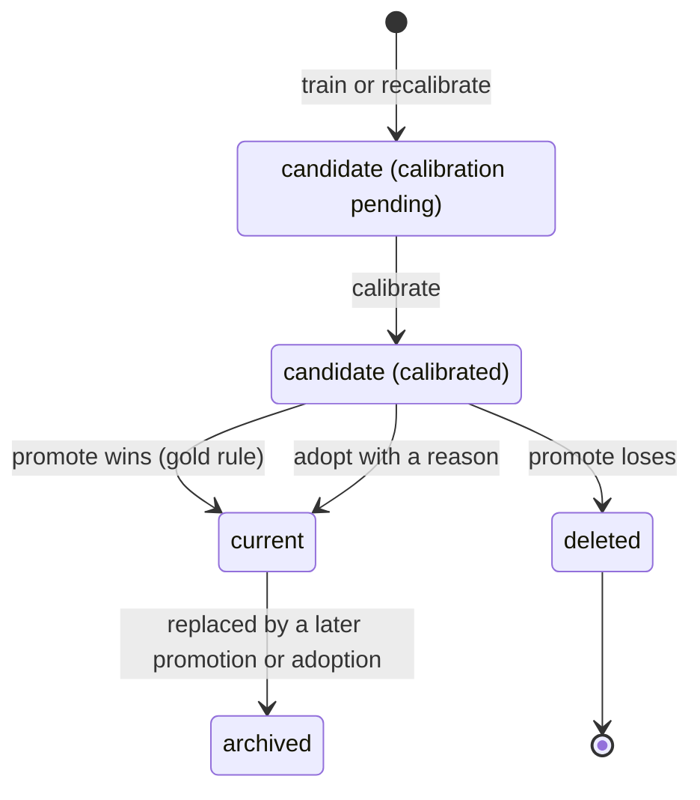
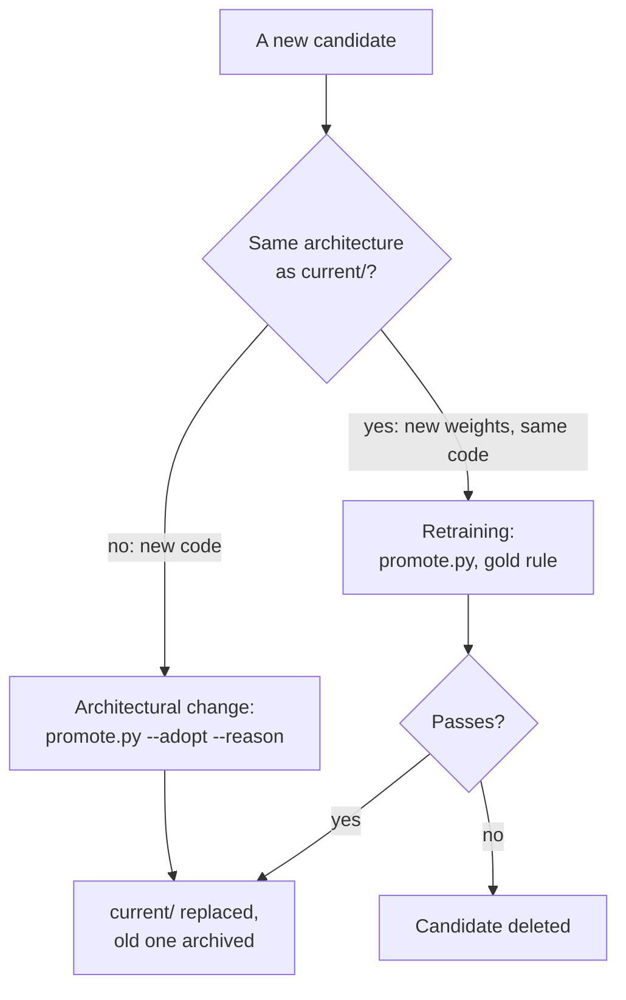

# Generations

How the ML side versions its outputs: the layout of a report-mapping generation, its manifest, the
spec check, the data splits, the leakage guards, the two kinds of model improvement, the retraining
triggers, `retrain_cycle.py` and the archive. For the ML developer or Admin who trains and promotes
models. Package: `ml/generations/` (`manifest.py`, `splits.py`, `guards.py`, `promote.py`,
`triggers.py`), plus `report_mapping/generation.py`. Entry points: `scripts/split.py`,
`scripts/generations.py`, `scripts/promote.py`, `scripts/retrain_cycle.py`. Commands for each task
are in [train-and-promote.md](../how-to/train-and-promote.md); every flag is in
[scripts-and-flags.md](../reference/scripts-and-flags.md). The decision to restructure the lifecycle
around one model is [ADR 0009](../history/decisions/0009-bronze-restructure-and-lifecycle.md).

Production `current/` is `gen-20261009T224439Z` (split `three-way-v1`, silver `silver-0-legacy`),
the first generation of the joint ModernBERT design, adopted through ADR 0009. No `candidate/`
exists.

## Lifecycle



- `train.py` writes into `candidate/`, never `current/`. It stamps a manifest with
  `calibration.status: "pending"` and writes no `thresholds.json`.
- `calibrate.py` fits the thresholds and the review cut on the calibration partition and flips the
  status to `calibrated`. Every loader refuses a generation that is not calibrated, except
  `calibrate.py` itself.
- `promote.py` decides whether a retrained candidate replaces `current/`. A winner takes `current/`
  and the old incumbent is archived. A loser is deleted.
- `promote.py --adopt --reason PATH` swaps in a candidate built by new code, without the rule
  ([below](#two-kinds-of-improvement)).
- `generations.py recalibrate` copies a generation's weights into a new, uncalibrated candidate
  ([below](#recalibrate)).
- `adopt_published` (in `generations/promote.py`, used by `sync.py pull-model`) swaps in a verified
  `candidate/` without the scoring rule, because the generation was already promoted on another
  machine. It archives the incumbent the same way. See [sync-with-s3.md](../how-to/sync-with-s3.md).

## Layout

A generation directory is also the bundle the cloud worker loads ([handoff-contracts.md](../reference/handoff-contracts.md)).
`current/` is production and `candidate/` is the one being trained or evaluated, both under
`config.REPORT_MAPPING_DIR`.

```
encoder/            HF ModernBERT weights (model.safetensors), tokenizer files, config.json
head.pt             term head (fp32)
gate_head.pt        gate head (fp32)
terms.json          term vocabulary, in head order
term_info.json      term -> [group, code], a snapshot of ml/taxonomy/labels.csv (first occurrence of each term)
thresholds.json     gate_t, tau, rho, review_cut, max_fp_share, review_target_share (written by calibrate.py)
manifest.json
```

There is no embedding cache and no embedding fingerprint: the model reads the text itself, so there
is nothing derived to go stale. Model code: [report-mapping.md](report-mapping.md).

## Manifest

Every generation directory (a split, a silver generation, `current/`, `candidate/`) has a
`manifest.json` from `manifest.py`: the caller's fields plus `created_at` (ISO UTC), `git_sha` (the
code's HEAD) and `files`, a sha256 for every file under the directory. `verify_manifest` refuses a
directory whose listed files are missing or changed, or that holds a file the manifest does not
list. `update_manifest` changes top-level fields in place (used to flip `status`) without
re-stamping `files`, `created_at` or `git_sha`.

A report-mapping manifest also records:

| Field | Content |
|---|---|
| `kind`, `schema_version` | `report_mapping_generation`, 2 |
| `generation_id` | `gen-<UTC timestamp>` (for example `gen-20261009T224439Z`), minted when the generation is written. It is also the cloud's `source_version`. |
| `status` | `candidate`, `current` or `archived`, set by promotion and adoption |
| `architecture` | `name` (`joint-modernbert-v1`), `text_spec_version`, `pooling` (`mean`), `heads` (`term`, `gate`), `decision_rule` (`gate-top1-rank2-v1`). What the code must match. |
| `model` | `encoder_id`, `weights_sha256` (over `encoder/model.safetensors`, `head.pt`, `gate_head.pt`, `terms.json`), `n_terms`, `max_length` (4096) |
| `recipe` | The resolved hyperparameters |
| `parents` | `split_id`, `labels_source`, `silver_id`, `gold_train_snapshot`, `gold_train_codes`. What the generation trained on. |
| `training` | `seed`, `device`, `library_versions`, `n_train`, `n_holdout`, the hold-out metrics and the per-epoch log |
| `calibration` | `status` (`pending` or `calibrated`), `partition`, `split_id`, `labels`, `n_cases`, `n_cases_with_text`, `objective`, `grid`, `values`, `max_fp_share`, `review_target_share`, `weights_sha256`, and the in-sample verdicts |
| `adoption` | `reason` (repo-relative path of the ADR) and `adopted_at`; only on a generation that `promote.py --adopt` put in place |
| `recalibrated_from` | The source generation's id; only on a recalibrated generation |

## The spec check

`report_mapping.generation.verify_spec` is the one check every loader runs: `predict.py`, the
cloud worker at start-up, `handoff.py export-bundle`, `sync.py publish-model`, `promote.py` and the
adopt. It raises `GenerationError` rather than load a generation that is not whole or not built for
this code. It requires, in order:

1. every file matches the hash in `manifest.json`, and no listed file is missing or unlisted;
2. the manifest is a `report_mapping_generation` of schema 2;
3. its `architecture` block equals the code's, including the text spec version, so a generation
   built on other text, other heads or another decision rule is refused;
4. `model.weights_sha256` matches the weight files, and `model.n_terms` matches `terms.json` (the
   term head's width is checked again when the model is loaded);
5. unless the caller is `calibrate.py`, `calibration.status` is `calibrated` and
   `calibration.weights_sha256` equals the generation's own: thresholds fitted for other weights are
   refused.

The check only protects a generation directory that is kept whole, which is why promotion and
adoption move it as one unit. A generation from the PetBERT era fails step 3, and a new generation
fails the old worker image: image and bundle switch together
([handoff-contracts.md](../reference/handoff-contracts.md)).

## Two kinds of improvement

The process is built around one model, so a change to it is one of two kinds. Which kind it is
decides how it gets into production.



### Retraining: gold only

A retrain (same code, new weights, trained from the base checkpoint) is judged by `promote.py` on
**gold only**. The challenger (`candidate/`) and the incumbent (`current/`) are both scored on the
current gold-eval, the same cases, with the incumbent re-scored every time because gold-eval grows
between runs, against the one uncommon-groups ruler ([evaluation.md](evaluation.md)). Promote only
if both hold:

1. at least one retraining trigger is met ([below](#retraining-triggers));
2. the lower 95% bound of the paired (challenger minus incumbent) `good`-share difference, from a
   stratified case-cluster paired bootstrap, is at least `MARGIN` (-2.0 pp). Good is the primary
   metric; G+S is shown beside it.

There is **no silver fallback**: without gold-eval rows `promote.py` refuses. Before comparing it
runs `check_all`, runs the spec check on the candidate, verifies `current/`'s manifest, refuses a
candidate with the same `generation_id`, and refuses a candidate whose `architecture` block differs
from current's, pointing to `--adopt`. Without `--apply` it only recommends. With `--apply`:

- a winner is swapped in after the incumbent is archived (see [Archive](#archive)); the candidate is
  re-verified immediately before anything moves;
- a loser is deleted, and the incumbent stays in place;
- `--description` names the archive folder (default: the incumbent's `generation_id`);
- `--publish` (requires `--apply` or `--adopt`) then publishes the new `current/` to S3, and is
  ignored when nothing was promoted. See [sync-with-s3.md](../how-to/sync-with-s3.md).

`retrain_cycle.py --apply` (opt-in) runs `promote.py --apply` automatically, but only when the rule
passes; without the flag the cycle only recommends. Until gold-eval is representative
([evaluation.md](evaluation.md)), the recommendation is indicative and a person decides. No real
gold exists yet, so this cannot run for real today.

### Architectural change: adopt with a reason

A candidate built by new code (a different architecture block: a new text spec, other heads, another
decision rule) is not a retraining and has no gold rule to pass. A person adopts it:

```bash
ml/.venv/Scripts/python.exe ml/scripts/promote.py --adopt --reason ml/documentation/history/decisions/NNNN-title.md
```

`--reason` must be an existing file under `ml/documentation/history/` (an ADR); `promote.py` refuses
otherwise. Adopt refuses a candidate that has the **same** architecture as `current/` (that is a
retrain), and refuses `--apply` together with `--adopt`. It runs the spec check on the candidate,
archives `current/` whole, swaps the candidate in and records `adoption: {reason, adopted_at}` in the
new `current/` manifest, so `generations.py status` shows why each generation was adopted. If there
is no `current/`, the candidate is renamed into place. The first adoption, of the restructure
itself, is [ADR 0009](../history/decisions/0009-bronze-restructure-and-lifecycle.md).

### Recalibrate

New thresholds for the same weights are a **new generation id**, because a generation is calibrated
once and its thresholds are bound to its weights. `generations.py recalibrate --labels L` copies a
calibrated generation (default `--from current`, `--to candidate`; the source must pass the spec
check and the destination must not exist) with a new `generation_id`, calibration `pending`, no
`thresholds.json`, and `recalibrated_from` set; the weights, architecture and parents are
unchanged. It then runs `calibrate`. The result is an ordinary candidate: predict with it, then
`promote.py` judges it by the same gold rule as a retrain.

## Splits

`config.SPLITS_DIR/<split_id>/{train,calibration,test}_cases.txt` plus a manifest. A split is
immutable once written: every writer refuses to overwrite an existing `<split_id>/`. `load_split`
verifies the manifest, then reads only the partition files it lists. A partition it does not list
loads as an empty set.

- `legacy-80-20` (46,652 train, 11,661 test) has no calibration partition. `legacy-temporal`
  (56,905 train, 1,408 test) is the drift check and has none either.
- `split.py create --parent P --id ID` derives a three-way split from a two-way parent. Train is
  copied unchanged. The parent's test cases are divided by an md5 half rule
  (`int(hashlib.md5(case_id.encode()).hexdigest(), 16) % 2 == 0` goes to calibration, otherwise to
  test; `generations.splits.in_sweep_half`). `three-way-v1` (parent `legacy-80-20`) has 46,652
  train, 5,828 calibration and 5,833 test cases. It is `config.DEFAULT_SPLIT_ID`, the `--split`
  default of `train.py`, `calibrate.py`, `oof.py`, `promote.py`, `generations.py` and
  `retrain_cycle.py` (the other scripts require `--split`).
- Roles: train fits the models, calibration fits the thresholds, test is where gold-eval lives.
  See [icd-mapping-strategy.md](icd-mapping-strategy.md).
- `split.py check --split ID` runs every applicable guard and exits 1 on any violation.

## Leakage guards

`guards.py` holds pure checks over case-id sets and dataframes plus a `Split`. Each raises
`GuardViolation` naming the count and a few example case IDs (IDs only, never text). `check_all`
loads whichever stores exist and runs every applicable guard, collecting all violations into one
error:

- partition disjointness, and a derived split covering its parent exactly;
- every gold-store row has a known origin;
- gold-eval is inside the test partition (`eval_batch` must be in test; `random_slice` is a
  violation only when it is in train or calibration);
- gold-train-origin gold on an eval-side case (calibration or test) never enters training labels;
- training labels, and the corrected annotations, contain train-partition cases only
  (`check_labels_train_only`). Trainers run it on the frame already filtered to train, never on the
  whole-universe table, which fails by design;
- calibration reads calibration-partition cases only (`check_calibration_inputs`), and
  `calibrate.py` also refuses cases the generation itself trained on;
- the audit store never feeds the corrected annotations (`check_corrected_sources`).

Gold has five origins. `GOLD_EVAL_ORIGINS` are `eval_batch` and `random_slice`. `GOLD_TRAIN_ORIGINS`
are `review_queue` and `report_mapping_audit`. `diagnosis_mapping_audit` is neither. The full
origin table is in [manual-audit.md](manual-audit.md).

Where the guards run: `split.py check`, `train.py`, `oof.py`, `calibrate.py`, `evaluate.py gold`
and `promote.py` (the retraining recommendation) run `check_all`. `split.py check` cannot exercise
the calibration-inputs guard; that one runs inside `calibrate.py`. Training also filters labels to
the train partition and runs the two train-only label guards. An architectural adopt runs the spec
check but not `check_all`: it makes no comparison on data.

## Retraining triggers

`triggers.py` reports each `Trigger` as met or not met plus the numbers behind it. The thresholds
are placeholders to settle on real data.

1. `new_silver_lineage`: the challenger's `parents.silver_id` differs from the incumbent's. Not met
   when either side is unknown.
2. `random_slice_drop`: on the latest upload period's random slice, the incumbent's weighted `good`
   share is below its share on the rest of gold-eval, and the two 95% stratified case-cluster
   bootstrap intervals do not overlap. The latest period is left out of the reference sample so the
   two are disjoint.
3. `gold_train_growth`: gold-train codes now, minus the count the incumbent trained on
   (`parents.gold_train_codes`, 0 for a generation trained on silver only), is at least
   `GOLD_TRAIN_GROWTH` (200). A re-reviewed case whose code set is only replaced does not count as
   new.

Falling bronze-vs-silver agreement on diagnosed uploads is not a trigger; it is a drift warning.

`generations.py status --silver SID` prints `current/`, `candidate/` and the archive (generation id,
status, architecture, calibration, silver, split, gold-train codes, and for an adopted generation
what it was adopted for) and whether a challenger trained on `--silver` would meet a trigger.
Without gold-eval the random-slice trigger cannot fire.

## `retrain_cycle.py`

The local lane in one command. It recommends by default; `--apply` (opt-in) promotes when the gold
rule passes. Each step is the existing entry point run as its own process, so GPU memory is freed
between steps:

1. Refuse to start if `candidate/` exists (promote or delete it first).
2. Import gold if `--gold-csv` is given.
3. Stop unless gold-eval exists (it prints `STOP`; this is today's outcome).
4. Run `predict.py` for `current/` if its predictions are missing.
5. Stop unless a trigger fires (`--force` overrides, but `promote.py` still needs a trigger).
6. `code_cases.py corrected` builds the training labels.
7. `train.py --out candidate`, one step from the base checkpoint.
8. `calibrate.py --labels <silver_id>`. The corrected table covers the train partition only, so the
   calibration partition is labelled by silver.
9. `predict.py` for `candidate/`.
10. `promote.py`: without `--apply`, or with it only when the cycle's own `recommend` call says the
    rule passes; otherwise the cycle only recommends and the candidate is kept.

It never runs the LLM cascade; a new silver generation is its own step (`map_diagnoses.py`, see
[diagnosis-mapping.md](diagnosis-mapping.md)).

## Archive

`config.ARCHIVE_ROOT` (`output/archive/`) is a sibling of `output/report_mapping/`. It is written
only by `generations/` and never loaded from. Promotion or adoption moves the incumbent there whole
(encoder, both heads, vocabulary, thresholds and manifest) as `ARCHIVE_ROOT/YYYY-MM-DD_<description>/`:

- `current/` is renamed into the archive, then `candidate/` is renamed to `current/`. Both are
  same-filesystem renames. If the second fails the first is undone, so `current/` is never left
  half-moved or empty. A second archive of the same name on the same day is refused; pass another
  `--description`.
- The manifest statuses are then set (`archived`, `current`), and an adoption records its `adoption`
  block.
- A losing candidate is deleted, not archived. There is no restore-from-archive step; the incumbent
  is only ever archived after a win or an adoption.
- The generation the restructure replaces (the PetBERT `current/` on the main machine) is archived whole this way
  when the first architectural adopt runs there (see the main-tree cutover runbook in
  [the restructure plan](../history/plans/restructure-plan.md)). It fails today's spec check, so only the code at git tag `pre-restructure-2026-10-09` can load it.
