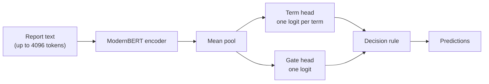
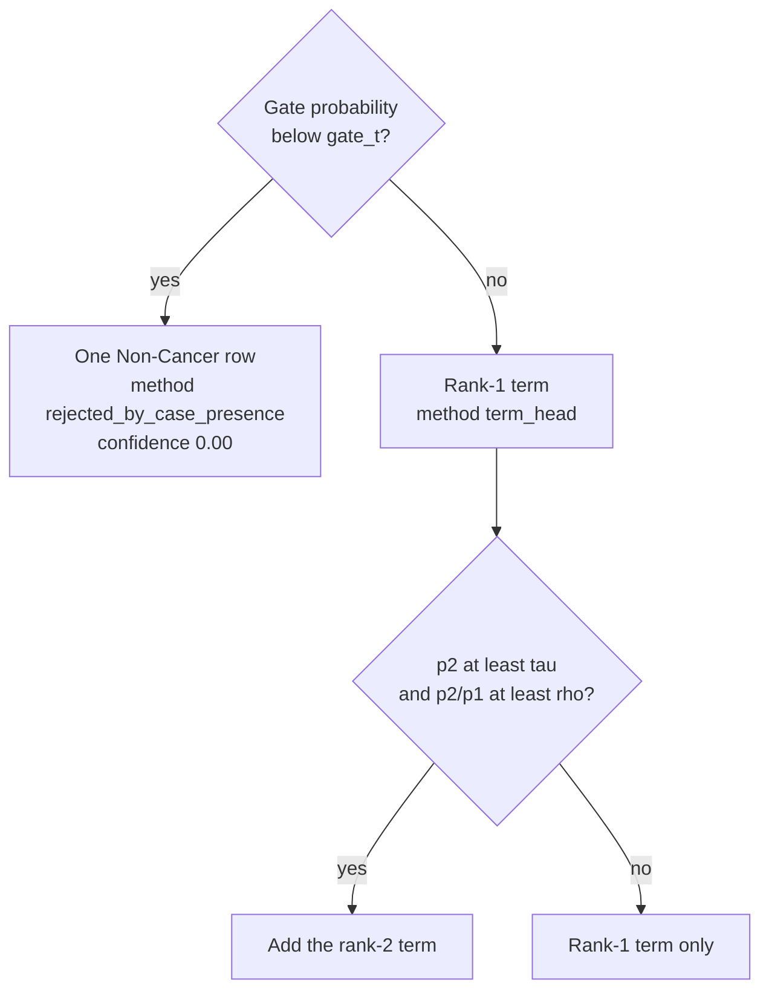

# Report mapping (bronze)

How a pathology report becomes a Vet-ICD-O-canine-1 label, independent of any diagnosis text. One
jointly trained BioClinical ModernBERT reads the whole report once and answers two questions: is
there a cancer diagnosis (the gate) and which term (the term head). This is the concept doc for the
ML developer: the input text, the model, the decision rule, calibration and the review cut, training
and why the design is this one. Package: `ml/report_mapping/` (`text.py`, `batching.py`, `model.py`,
`generation.py`, `inference/`, `training/`). Entry points: `scripts/train.py`, `scripts/calibrate.py`,
`scripts/predict.py`, `scripts/oof.py`. Where bronze fits in the overall approach:
[icd-mapping-strategy.md](icd-mapping-strategy.md). The decision record is
[ADR 0008](../history/decisions/0008-joint-modernbert-report-mapping.md); the PetBERT four-stage
pipeline this replaced is archived in
[history/legacy-tree/four-stage-pipeline.md](../history/legacy-tree/four-stage-pipeline.md).

Production `current/` is `gen-20261009T224439Z`, the first generation of this design. Its numbers
are under [First generation](#first-generation).

## Input text

`text.py` builds one string per report from the eight text columns of `report.csv`, in this order
(`REPORT_COLUMNS`):

`CLINICAL ABSTRACT`, `GROSS DESCRIPTION`, `HISTOPATHOLOGICAL SUMMARY`, `COMMENT`, `FINAL COMMENT`,
`ANCILLARY TESTS`, `ADDENDUM`, `ADDITIONAL INFORMATION`.

- Each non-empty column becomes `"HEADING: text"` after `clean_text` (missing or NaN becomes empty,
  everything else is stripped), and the parts are joined by a newline. Nothing is dropped, merged
  or regrouped.
- A missing column counts as empty, so an upload that carries only some columns is read the same
  way as a `report.csv` row.
- **A case has text if and only if any of the 8 columns is non-empty** (`has_text`). Only such cases
  are scored and get prediction rows. This replaces the old three-section rule: all 58,313 report
  rows have text under it, against 58,172 under the old one, so 141 cases (109 train, 17
  calibration, 15 test) are scored that were not before.
- `TEXT_SPEC_VERSION` (now 1) is recorded in every generation. Any change to the columns, order,
  headings or cleaning must bump it, and a generation built on another version is refused by the
  spec check ([generations.md](generations.md#the-spec-check)).
- `report.csv` is read as latin-1 (`read_reports`).
- Uploads to the cloud worker carry one `Text` column. The worker feeds it flat, with no heading:
  measured on calibration against the full headed text it cost about half a point of false
  positives, nearly offset by fewer false negatives
  ([handoff-contracts.md](../reference/handoff-contracts.md#the-worker-bundle-contract-worker_formatpy)).

## The model

- **Encoder.** `thomas-sounack/BioClinical-ModernBERT-base` (`model.ENCODER_ID`), loaded with `sdpa`
  attention (flash-attention is not available on Windows) and `reference_compile` off (it needs
  triton). `max_length` is 4096 tokens; a longer report is cut, keeping the closing separator token.
- **Pooling.** Mean over the attended tokens, not the first token. The encoder is pretrained as a
  masked language model with no first-token objective, and the diagnosis can be stated anywhere in a
  multi-thousand-token report.
- **Two heads, both fp32 linear layers on the pooled vector.** The term head has one logit per term
  of the generation's vocabulary (`terms.json`). The gate head has one logit: is there a cancer
  diagnosis. One encoder pass gives both. The heads stay in fp32 even where the encoder runs in bf16,
  because bf16 logits tie ranks.
- **Vocabulary.** The sorted set of terms that the train cases carry. The first generation has 455
  terms, so a taxonomy term that no train case carries can never be predicted (the likely
  out-of-vocabulary case is caught by the review cut below).
- **Term to group and code** come from the generation's own `term_info.json`, a snapshot of
  `ml/taxonomy/labels.csv` (first occurrence of each term). Inference never reads the taxonomy file,
  which is why the cloud worker image does not contain it.
- **Precision.** Inference autocasts the encoder to bf16 on CUDA only; on CPU everything is fp32.
  Training does the same, with gradient checkpointing.

## The decision rule

`inference/decide.py` turns the gate probability and the ranked term probabilities (sigmoids; the top
49 per case are kept) into prediction rows. The thresholds are in the generation's `thresholds.json`.

| Threshold | Frozen value (first generation) | Meaning |
|---|---|---|
| `gate_t` | 0.75 | Gate probability below this: the case is rejected as non-cancer |
| `tau` | 0.10 | Minimum rank-2 probability for a second term |
| `rho` | 0.25 | Minimum ratio rank-2 / rank-1 probability for a second term |

- A rejected case gets exactly one row: term and group `Non-Cancer`, no code, confidence `0.00`,
  method `rejected_by_case_presence`.
- An accepted case gets its rank-1 term, plus the rank-2 term only when both `tau` and `rho` hold,
  with method `term_head`. `confidence` is the term's sigmoid probability to two decimals.
- The predictions CSV keeps its ten columns in order: `case_id, diagnosis_index, predicted_term,
  predicted_group, predicted_code, case_presence_prob, confidence, group_prob, method,
  generation_id`. `case_presence_prob` is the gate probability to four decimals; `group_prob` is
  always blank (there is no group stage). A case with no text gets no row. Column and file
  contracts: [handoff-contracts.md](../reference/handoff-contracts.md).
- `unidentified_cancer`, `label_presence`, `lipoma_rescue` and `retriever_top1` are never produced.
  The old method name `retriever_top1` is now `term_head`.

`inference/predict.py` has three entry points over the same scoring: `run_predict` (the CLI path:
`report.csv` to a predictions CSV), `predict_frame` (report columns in memory) and `predict_texts`
(already-built texts; the cloud worker). `load_generation` runs the spec check first, so no
generation that fails it is ever scored with.

## Calibration

`training/calibrate.py` fits the three thresholds and the review cut on one split's `calibration`
partition. Gate, tau and rho are searched jointly on a fixed grid:

| Parameter | Grid |
|---|---|
| `gate_t` | 0.05 to 0.95 in steps of 0.05 |
| `tau` | 0.1 to 0.9 in steps of 0.1, plus "never" (a value above every probability: no second term) |
| `rho` | 0, 0.25, 0.5, 0.75 |

- **Objective.** The G+S share of the `evaluation.verdicts` table of the predictions against the
  labels on the partition, among the grid points whose **false-positive share of the verdict rows is
  within the FP cap**. Ties go to the higher Good share, then to the first grid point in
  (gate_t, tau, rho) order. The cap is `config.FP_CAP` = 0.0243, WP14's calibration false-positive
  share, so a new generation cannot buy recall with more false positives than the generation it
  replaces; `--max-fp-share` overrides it. If no grid point is under the cap, calibration raises and
  never relaxes it.
- **Labels.** A silver id or a labels CSV with rows on the calibration partition. The corrected
  annotations cover the train partition only, so calibration refuses them; calibrate against the
  silver id.
- **What is scored.** Only cases with text. A labelled calibration case without text counts as a
  false negative at every grid point. The number of cases with text is recorded in the manifest.
- **Leakage.** `guards.check_all` runs, and calibration refuses a case that is in the train
  partition of the generation's own split.
- **Once per generation.** A generation is calibrated exactly once: `calibrate.py` refuses one that is
  not `pending`. New thresholds for the same weights are a new generation
  (`generations.py recalibrate`, [generations.md](generations.md#recalibrate)).
- **Output.** `thresholds.json` (`gate_t, tau, rho, review_cut, max_fp_share, review_target_share`)
  and the manifest's `calibration` block, bound to the generation's `weights_sha256`: the grid, the
  fitted values, the case counts, the in-sample verdict counts and shares, and the G+S and Good shares
  along the `gate_t` axis. The manifest is rewritten last, so a partial write never leaves loadable
  but wrong thresholds in place.

### The review cut

`review_cut` is the confidence below which an accepted case goes to the review queue
([coding.md](coding.md#the-bronze-review-rule)). It is fitted per generation, after the thresholds:
the cut that queues `config.REVIEW_TARGET_SHARE` = 0.2336 of the accepted calibration cases (WP14's
calibration review volume, 592 of 2,534 accepted cases). It is fitted on the two-decimal rank-1
confidences, which is what the predictions CSV carries, so the queue rule applied to that CSV
reproduces the fitted share. A case where the gate accepts but no term is confident falls below the
cut, which is how a term outside the vocabulary reaches the specialist.

## Training

`training/recipe.py` is the single source of the production hyperparameters and seeding
(`seed_all` covers python, numpy, torch and CUDA). `tests/test_rm_training.py` pins these values.

| Recipe | Value |
|---|---|
| epochs | 3 |
| cases per optimizer step (`batch_size`) | 32, cut into micro-batches of at most 16,384 padded tokens (`token_budget`) |
| learning rate | 5e-5 for the encoder, 1e-3 for the two heads (AdamW, weight decay 0.01) |
| schedule | linear warmup over the first 10% of steps, then linear decay; gradient clipping at 1.0 |
| `max_length` | 4096 tokens |
| gradient checkpointing | on |
| `gate_weight` | 1.0 |
| hold-out | 5% of the cases, stratified on the gate target, fixed seed 1234, never trained on |
| seed | `PRODUCTION_SEED` = 42 (`--seed` overrides it per run) |

- **Loss.** Term loss plus `gate_weight` times gate loss. The term loss is binary cross-entropy over
  all terms, summed over the **cancer** cases of the step and divided by their number; a non-cancer
  case has an all-zero term row and would only teach "no term", so it contributes nothing there.
  The gate loss is binary cross-entropy over every case. Both are divided by their step's count, so
  micro-batches add up to the loss of the whole step. Output biases start at the train priors.
- **Cases.** The train partition's cases that have text and at least one row in the labels table
  (`training/labels.py`, `training/data.py`). A case in train with no label row (for example a vague
  case without gold that the corrected annotations leave out) is not trained as non-cancer. A case is
  a gate positive if it has at least one non-empty term.
- **Every retrain starts from the base checkpoint** (`--model`, default the production encoder) with a
  fresh head over the train partition's terms. There is no warm start.
- **Output.** `train.py` writes a generation with `calibration.status: "pending"` and no
  `thresholds.json`, plus the hold-out metrics (gate AUC and loss, term top-1, pair recall at 20) in
  the manifest. It records the encoder id, the recipe, the parents (split, labels source, silver id,
  gold-train snapshot and code count), the seed, the device and the library versions. Leakage guards
  run first. The lifecycle after training is in [generations.md](generations.md).
- **Cross-fit.** `training/crossfit.py` (via `scripts/oof.py`) runs the same loop k times (default 5)
  over the train partition, each fold scored by a model that never saw it. The output is numbers only
  and feeds the Report-Mapping audit ([manual-audit.md](manual-audit.md#the-report-mapping-audit)).

## First generation

`gen-20261009T224439Z` is the weights of the retrieve-and-rerank v2 experiment's jointly trained
model (`rr-20261008T210937Z`), frozen and re-housed in this layout, not retrained. It was trained on
the raw silver `silver-0-legacy` (vague cases included); retrains use the corrected annotations. Its
thresholds are the frozen values above, with `review_cut` 0.85, which queues 23.23% of the 2,596
accepted calibration cases (target 23.36%). A refit under the FP cap picks the same thresholds.
ADR 0009 adopts it as the first generation.

One-shot test on the held-out `three-way-v1` test partition, scored against silver (so agreement with
silver, not accuracy), with the same uncommon-groups ruler as the generation it replaced:

| | Good | Slight | CO | FP | FN | G+S |
|---|---|---|---|---|---|---|
| This design (`rr-20261008T210937Z`) | 58.47 | 10.60 | 10.92 | 2.14 | 17.87 | 69.07 |
| WP14 four-stage (`gen-20260927T025939Z`) | 46.27 | 15.86 | 12.84 | 2.35 | 22.68 | 62.13 |

Paired case-cluster bootstrap, this design minus WP14 (percentage points): Good +12.20 [+10.91,
+13.60], Slight -5.26, CO -1.92, FP -0.21 [-0.82, +0.32], FN -4.80, G+S +6.94 [+5.53, +8.48]. The
pre-registered bars (Good lower bound at least -2, G+S at least WP14's, FP at most WP14's plus 1) all
passed. Slight fell as Good rose, consistent with exact terms replacing right-group-wrong-term
ones. The test partition is now **spent** for this design: never tune on it.

In-sample on the calibration partition at the frozen thresholds (4,081 verdict rows, with the 17
extra cases of the 8-column rule): Good 60.06, Slight 9.21, CO 11.17, FP 2.23, FN 17.32, G+S 69.27.
Under the old has-text rule these equal the freeze record exactly (4,079 rows: Good 59.99, Slight
9.19, CO 11.18, FP 2.18, FN 17.46).

CPU fp32 (torch 2.9.1, the worker's pins) against GPU bf16 on the whole calibration partition: Good
-0.03, Slight +0.05, CO +0.05, FP 0.00, FN -0.07 pp, and 21 of 5,828 cases change decision.

## Why this design

**Why one joint model.** The four-stage pipeline spent a gate, a group classifier, per-group heads
and keyword rules to reach a term. One encoder trained jointly for the gate and the term head beat
that pipeline on a one-shot test against bars fixed in advance (table above), with one encoder pass
per report. The experiment that chose it,
and the retrieve-and-rerank designs it beat, are in
[ADR 0008](../history/decisions/0008-joint-modernbert-report-mapping.md).

**Why the whole report, nothing regrouped.** The four-stage model embedded three hand-picked sections
and dropped the rest. Here all eight columns are one text under their headings, so the model finds
the diagnosis wherever it is stated, and a missing column needs no special case (which is also what
lets an upload carry a single text field).

**Why the gate stays.** The term head is trained on cancer cases only, so it has no notion of "no
cancer". The gate is the part that says so, and it is what the FP cap in calibration constrains.

**Why a fixed FP cap and a fitted review cut.** Calibration maximizes G+S, and a lower gate threshold
accepts more cases at the price of more false positives, so the cap holds them at the previous
generation's level. The
review cut pins the specialist's workload at the previous generation's volume instead of letting a
more confident model silently shrink or grow the queue.

**Why thresholds are re-fitted after every training run.** Score distributions move with the weights.
Thresholds are fitted on the calibration partition, never on the test partition and never on gold-eval,
and a generation is bound to the thresholds fitted for its own weights.
