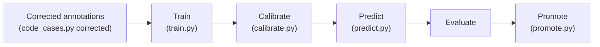

# Train and promote a generation

Exact commands to train a candidate report-mapping generation, calibrate it, predict with it and
promote or adopt it. For maintainers running a retrain. The design behind each step is in
[report-mapping.md](../concepts/report-mapping.md); the promotion rule, the adopt route, the
retraining triggers and the archive are in [generations.md](../concepts/generations.md); every flag
is in [scripts-and-flags.md](../reference/scripts-and-flags.md).

## Where things stand

Production `current/` is `gen-20261009T224439Z`, the first generation of the joint ModernBERT design
(frozen weights re-housed, thresholds frozen; adopted through
[ADR 0009](../history/decisions/0009-bronze-restructure-and-lifecycle.md)). There is no `candidate/`,
and no gold exists yet. So **`retrain_cycle.py` currently prints `STOP: no gold-eval rows ...` and
trains nothing**, and `promote.py` refuses for the same reason (a retrain is judged on gold-eval
only, with no silver fallback). Steps 1 to 7 below still run; step 8 needs gold. Runs on mock gold
are test-only and their numbers are never quoted.

## Two kinds of change

| You changed | Route | Judged by |
|---|---|---|
| Weights only (new labels, new seed, more gold): same code | Steps 1 to 8 below, or `retrain_cycle.py` | `promote.py`: the gold rule and a trigger |
| The code of the model (text spec, heads, decision rule): the `architecture` block differs | [Adopt an architectural change](#adopt-an-architectural-change) | A person, with a written reason |
| Only the thresholds | [Recalibrate](#recalibrate) | Same as a retrain |

## Training order



`train.py` is one step: it trains the joint model (term head and gate head together) from the base
checkpoint and writes a candidate with calibration `pending`. Calibration fits the thresholds and the
review cut and flips the candidate to `calibrated`; every loader refuses an uncalibrated generation.

## Prerequisites

- **Python:** `ml/.venv/Scripts/python.exe` on Windows, `ml/.venv/bin/python` on macOS and Linux
  (commands below use the Windows path). Set-up is in
  [new-machine-setup.md](new-machine-setup.md). Scripts add `ml/` to `sys.path` themselves.
- **Device:** `--device cuda` on the RTX 5070 Ti. `--device auto` (the default of every script that
  takes a device) picks cuda when available, else cpu; `cpu` and `cuda` force one. Training on cpu is
  correct but far slower.
- **A split:** `three-way-v1` (`config.DEFAULT_SPLIT_ID`) exists; every command below defaults to it.
- **A silver generation** to train on: an existing `silver_id` (`silver-0-legacy`) or a new one from
  step 1.
- **No `candidate/` directory.** `retrain_cycle.py` refuses to start if one exists, and `train.py`
  refuses a non-empty output directory; promote or delete it first.

## Route 1: `retrain_cycle.py`

The local lane in one call. Each step runs as its own process, so GPU memory is freed between steps.

```bash
ml/.venv/Scripts/python.exe ml/scripts/retrain_cycle.py --silver silver-0-legacy --device cuda
```

It stops early when there is no gold-eval (today), or when no retraining trigger is met (`--force`
trains anyway; `promote.py` still needs a trigger). `--gold-csv PATH --export-id ID --reviewer NAME`
ingests a gold export first. It finishes with `promote.py` **without** `--apply`, so nothing is
promoted and you read the recommendation. Add `--apply` (opt-in) to let it run `promote.py --apply`
itself, and only when the gold rule passes; if the rule fails, the candidate is kept and nothing
moves. It never runs the LLM cascade. The step list and trigger rules are in
[generations.md](../concepts/generations.md#retrain_cyclepy).

## Route 2: stage by stage

Use this to stop between steps, rerun one step, or when the automatic route STOPs.

### 1. Diagnosis mapping (skip if the silver generation you need exists)

```bash
ml/.venv/Scripts/python.exe ml/scripts/map_diagnoses.py run --id silver-1
```

Writes a new immutable silver generation under `output/silver/silver-1/`. Needs LM Studio running
locally; takes tens of minutes on the full corpus. See
[diagnosis-mapping.md](../concepts/diagnosis-mapping.md).

### 2. Check whether a retrain is warranted

```bash
ml/.venv/Scripts/python.exe ml/scripts/generations.py status --silver silver-1
```

Prints `current/`, `candidate/` and the archive (ids, architecture, calibration status, silver,
split) and which retraining triggers are met. Note the `current/` generation id: step 8 needs it.

### 3. Corrected annotations

```bash
ml/.venv/Scripts/python.exe ml/scripts/code_cases.py corrected --silver silver-1 --split three-way-v1
```

Writes `output/coding/corrected_annotations.csv`: the training labels for the **train partition
only** (gold-train where it exists, silver elsewhere; see [coding.md](../concepts/coding.md)).
This is the `--labels` value for training. It is never the `--labels` value for calibration.

### 4. Train

```bash
ml/.venv/Scripts/python.exe ml/scripts/train.py \
    --labels ml/output/coding/corrected_annotations.csv --split three-way-v1 \
    --seed 42 --device cuda --out candidate
```

Trains the joint model on the split's train partition into `candidate/`, starting from the base
checkpoint with a fresh head over the train partition's terms. The candidate's manifest starts as
`calibration.status: pending` and there is no `thresholds.json`. Leakage guards run first and abort
on a violation ([generations.md](../concepts/generations.md)). `--model` starts from another
checkpoint directory or Hugging Face name. For a smoke test add `--limit 200 --max-steps 5` and
`--out` a scratch directory (it must be new or empty).

### 5. Calibrate

```bash
ml/.venv/Scripts/python.exe ml/scripts/calibrate.py --generation candidate \
    --labels silver-1 --split three-way-v1 --device cuda
```

Scores the calibration partition once and fits `gate_t`, `tau`, `rho` under the false-positive cap
(`config.FP_CAP`, 0.0243; `--max-fp-share` overrides it) and the review cut. **`--labels` is the
silver id**, as `retrain_cycle.py` does: the corrected table covers the train partition only, so
calibration refuses it with "labels ... have no rows on the calibration partition". The grid and
objective are in [report-mapping.md](../concepts/report-mapping.md#calibration). Writes
`thresholds.json` and sets `calibration.status: calibrated`. It prints the fitted values, the
in-sample G+S and Good, and the share of accepted cases the review cut queues. A generation is
calibrated once; it refuses a candidate that is already calibrated.

### 6. Predict with both generations

```bash
ml/.venv/Scripts/python.exe ml/scripts/predict.py --generation candidate --device cuda
ml/.venv/Scripts/python.exe ml/scripts/predict.py --generation current --device cuda
```

Each writes `output/predictions/<generation_id>_predictions.csv`. Skip the second if that file
exists. Details in [run-inference.md](run-inference.md).

### 7. Evaluate

```bash
ml/.venv/Scripts/python.exe ml/scripts/evaluate.py silver --predictions PATH --labels silver-1 --split three-way-v1 --partition calibration --generation candidate
ml/.venv/Scripts/python.exe ml/scripts/evaluate.py gold --predictions PATH --silver silver-1 --split three-way-v1 --generation candidate
```

`evaluate.py silver` scores against the labels table on one partition and works today. Do **not**
tune on `--partition test` of `three-way-v1` for this design: that partition was spent on its
one-shot test ([report-mapping.md](../concepts/report-mapping.md#first-generation)). The run is
refused when the predictions carry another generation's id, which is why `--generation candidate`
is needed for the candidate's predictions (the default is `current`). `evaluate.py gold` needs
gold-eval, so it cannot run for real until the reviewer returns gold. Report Good, Slight, CO, FP and
FN separately, with the split and n ([evaluation.md](../concepts/evaluation.md)).

### 8. Promote

```bash
ml/.venv/Scripts/python.exe ml/scripts/promote.py \
    --candidate-predictions ml/output/predictions/<candidate_id>_predictions.csv \
    --incumbent-predictions ml/output/predictions/<current_id>_predictions.csv
```

This step needs gold-eval and refuses today: a retrain is judged on gold only, with no silver
fallback. Without `--apply` it only prints the recommendation (guards, gold-eval comparison of Good
and G+S, triggers). To carry it out, rerun the same command with `--apply`: a winning candidate
replaces `current/` and the old generation moves whole to
`output/archive/YYYY-MM-DD_<description>/`; a losing candidate is deleted. Add
`--description short-name` to name the archive folder, and `--publish` (with `--apply`) to push the
new `current/` to S3 afterwards, which needs AWS credentials ([sync-with-s3.md](sync-with-s3.md)).
There is no restore-from-archive command.

```bash
ml/.venv/Scripts/python.exe ml/scripts/promote.py --candidate-predictions ... --incumbent-predictions ... --apply --publish
```

## Adopt an architectural change

When the model's code changes (the candidate's `architecture` block is not `current/`'s), `promote.py`
refuses it and points here. There is no gold rule and no trigger; a person decides and writes down
why.

1. Write the reason as a file under `ml/documentation/history/`, normally an ADR in
   `history/decisions/`.
2. Build the candidate with the new code: `train.py` and `calibrate.py` as above into `candidate/`
   (it must pass the spec check, so it must be calibrated).
3. Adopt:

```bash
ml/.venv/Scripts/python.exe ml/scripts/promote.py --adopt --reason ml/documentation/history/decisions/NNNN-title.md
```

Add `--description short-name` to name the archive folder and `--publish` to push the new `current/`
to S3. `--adopt` cannot be combined with `--apply`, needs `--reason`, and refuses a candidate with
the same architecture as `current/` (that is a retrain). The old `current/` is archived whole, and
the new `current/` manifest records the reason in `adoption`. Then update the cloud worker image and
bundle together ([handoff-contracts.md](../reference/handoff-contracts.md)); the first adoption's
change request is [restructure-change-request.md](../restructure-change-request.md).

## Recalibrate

New thresholds for the same weights are a new generation id.

```bash
ml/.venv/Scripts/python.exe ml/scripts/generations.py recalibrate --labels silver-1 --split three-way-v1 --device cuda
```

Copies `current/` into `candidate/` (`--from`, `--to` change that) with a new id and calibration
`pending`, then calibrates it (the FP cap defaults to `config.FP_CAP`, `--max-fp-share` overrides
it). Predict with the candidate and promote it as in steps 6 to 8: the gold rule judges it like a
retrain.

## Cross-fit for the Report-Mapping audit

The audit draws contradicted training labels from out-of-fold probabilities. Run the cross-fit once
per silver lineage or retrain; it trains five fresh models (estimated at 4 to 5 hours on the GPU, not yet run):

```bash
ml/.venv/Scripts/python.exe ml/scripts/oof.py --labels silver-1 --split three-way-v1 --device cuda
```

It writes numbers only under `output/report_mapping/oof/` and refuses to overwrite an existing file
without `--force`. The next step is in [run-audit-cycle.md](run-audit-cycle.md).

## Troubleshooting

**`REFUSED: ... is not empty`** (train). The output directory exists. Promote or delete the old
`candidate/`, or choose a new `--out`.

**`GenerationError: calibration.status is 'pending'`.** Run step 5. Only `calibrate.py` may load an
uncalibrated generation.

**`GenerationError: ... architecture ... is not the code's`.** The generation was built by other
code (a PetBERT-era generation, or a text spec, heads or decision rule that has since changed).
Retrain with the current code; do not edit the manifest.

**`GenerationError: the thresholds were calibrated for other weights`.** `thresholds.json` or the
manifest's calibration block does not belong to these weights. Recalibrate into a new generation.

**`REFUSED: ... is already calibrated; recalibrate it into a new generation`.** A generation is
calibrated once. Use `generations.py recalibrate`.

**`no grid point has a false-positive share <= ...`.** The FP cap cannot be met on this
calibration partition; calibration never relaxes it. Check the labels, or pass a deliberately higher
`--max-fp-share` and say so in the record.

**`REFUSED: ... no rows on the 'calibration' partition`.** `--labels` was the corrected annotations
(train-only). Pass the silver id.

**`GuardViolation`.** A leakage guard failed. The message gives case counts and a few example ids;
it names the invariant that broke. See [generations.md](../concepts/generations.md).

**Scores far below the incumbent.** Check that both runs use the same split, the same labels and the
same `evaluate.py` scope, and look at `manifest.json` (`calibration`) and `thresholds.json` of the
generation you scored. A mismatched generation shows up as a refusal, not as wrong numbers.

_Last verified against code: 2026-10-09_
